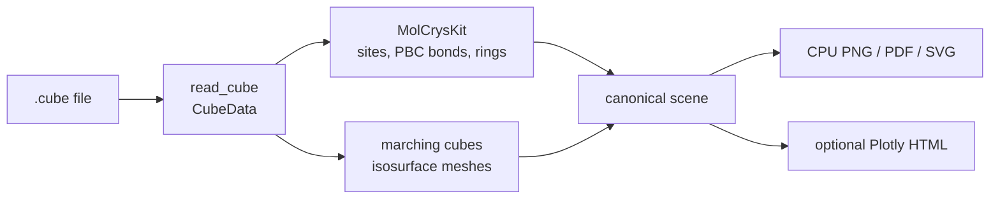

# Cube and isosurface API

Cube support is a volumetric-data adapter, not an independent chemistry
renderer. MatterVis parses the grid, sends the embedded atoms and periodic
cell through the canonical MolCrysKit structure contract, and then adds the
positive and negative isosurface meshes to the backend-neutral scene.



## Installation boundary

- Parse ordinary structures and render PNG/PDF/SVG: base `matter-vis`.
- Parse a Cube grid and extract isosurfaces: `matter-vis[cube]`.
- Render a Cube scene to Plotly HTML: `matter-vis[cube,plotly]`.
- Use Plotly/Kaleido static export: `matter-vis[cube,plotly-export]`.

Run `mat-vis capabilities --require cube --json` for the exact command in the
current environment. Importing `mat_viewer`, `mat_viewer.cube`, or
`mat_viewer.cube.core` does not import scikit-image or Plotly; those packages
are loaded only when their adapters are called.

## Agent-first entry points

Use the same public API as other structure formats:

```python
from mat_viewer.agent import load_structure, prepare_render, render

source = load_structure("density.cube")
plan = prepare_render(source)
result = render(plan, output="density.svg", backend="cpu")
```

The equivalent CLI is:

```console
mat-vis render density.cube -o density.svg --backend cpu --check --json
mat-vis render density.cube -o density.svg --backend cpu --json
```

`--check` resolves `[cube]` without loading the file or creating output.

For the optional Plotly frontend, `build_cube_figure(path, ...)` is the public
bridge. It still obtains atoms, bonds, image shifts, and display fragments from
the canonical loader before adding the isosurface overlay.

## Stable data surface

- `CubeAtom` and `CubeData` hold embedded atoms, origin, axes, and scalar data.
- `read_cube(path) -> CubeData` performs pure Cube IO.
- `cube_atom_trace(cube, theme="canonical")` and
  `atom_sphere_traces(cube, theme="canonical")` use the canonical MatterVis
  element palette by default. Pass `theme="cpk"` explicitly for the legacy
  bright CPK colors; this choice affects only the cube atom/bond overlays.
- `tile_cube` and `tile_cube_data` explicitly replicate a scalar grid.
- `default_isovalue(values, percentile)` chooses a threshold strictly inside
  the positive/negative value range or fails when no surface can exist.
- `cube_isosurface_meshes(cube, ...)` in `mat_viewer.cube.cpu` lazily uses
  scikit-image and returns backend-neutral vertices, triangles, normals,
  colour, and one shared shading material. Pass `color_cube` to attach
  per-vertex RGB sampled from a second `CubeData`. Those colors stay the
  albedo; the material shades them and does not add a scalar field.
- `ensure_cube_isosurfaces(structure)` attaches those meshes to the canonical
  scene consumed by CPU or Plotly renderers. Prepared meshes are kept only
  while the source grid, isovalue, stride, material, and color-cube settings
  are unchanged.

## Isosurface material

The shared record is `mat_viewer.render.isosurface_material.IsosurfaceMaterial`.
It is stored on each mesh at `metadata["material"]` and carries:

| Field | Default | Meaning |
|---|---|---|
| `ambient` | 0.68 | Weight of light that does not depend on the normal. |
| `diffuse` | 0.32 | Weight of `\|n · light\|`. Independent of ambient. |
| `specular` | 0 | Weight of the white highlight. |
| `shininess` | 32 | Blinn-Phong exponent, at least 1. Unused while specular is 0. |
| `opacity` | 0.55 | Surface alpha. The same value is copied to the mesh `opacity`. |
| `light_scale` | 1 | Multiplies diffuse and specular only. |

Ambient and diffuse are not required to sum to 1. The directional light is a
separate unit vector in camera space, `(-0.32, 0.42, 1)`, and `light_scale`
changes its strength without rewriting the surface weights. The shaded color
is clipped to `[0, 1]`. Coefficients are not renormalized.

A back-facing normal is flipped before the diffuse and specular terms, so the
scalar or phase color remains the albedo on both sides of a thin sheet.
Wireframe mode does not use this shade: its lines stay the phase or sampled
endpoint colors.

Two presets replace the light coefficients. Opacity can be combined with
either preset. A preset and an explicit light coefficient together is an
error.

| Preset | ambient | diffuse | specular | shininess | light_scale |
|---|---|---|---|---|---|
| `matte` | 0.62 | 0.55 | 0 | 32 | 1 |
| `glossy` | 0.38 | 0.72 | 0.18 | 16 | 1 |

`matte` is the print preset: the dark side of a fold stays near 0.62 of the
scalar color, and there is no highlight. `glossy` adds a broad highlight.
Omitting the preset keeps the historical 0.68 / 0.32 Lambert pair with
specular 0, so existing figures do not change until a coefficient or preset
is set.

```console
mat-vis render density.cube -o density.png --backend cpu \
  --isosurface-material matte
mat-vis render density.cube -o density.png --backend cpu \
  --isosurface-ambient 0.45 --isosurface-diffuse 0.70 \
  --isosurface-specular 0.15 --isosurface-shininess 24 \
  --isosurface-light-scale 1
```

| Backend | Surface shading |
|---|---|
| CPU PNG | Per-vertex Blinn-Phong when normals are present. Flat shading uses one illumination per face and still multiplies the vertex colors. Both sides keep the scalar color. |
| CPU SVG/PDF | One shaded color per triangle, after averaging vertex colors. The specular term is included. Rear faces keep that color. |
| Matplotlib | One shaded color per triangle for a uniform phase color. Per-vertex colors are still an error; use CPU or Plotly. |
| Plotly mesh | The same record is copied into Mesh3d lighting. Fresnel is 0 so the scalar color is not rim-tinted. Roughness is `1 / (1 + shininess / 32)`. Plotly clamps `ambient + diffuse * light_scale` to 1 before multiplying by the color, so a material above that clamp, including both presets, raises `IsosurfaceShadingUnsupported` instead of drawing a flatter sheet. The historical default sums to 1 and is accepted. Plotly's highlight is Cook-Torrance, not a bit-identical Blinn-Phong lobe. |
| Plotly volume (`orbital_isosurface_traces`) | Does not evaluate this record. Use the mesh traces or the CPU backend. |
| GPU | Rejects an isosurface mesh with `GPUUnsupportedError` before drawing. The current shader would otherwise store one flat color. Wireframe lines stay on the existing unlit line rules. |

`orbital_mesh_traces` now uses this record. Its previous fixed lighting
(ambient 0.85, diffuse 0.55, specular 0.2) is not the default anymore. The
trace `opacity` argument is unchanged and still defaults to 0.6.

## Isosurface color

`--isosurface-color-cube` samples a second cube onto the isosurface in
physical coordinates. The position of a mesh vertex is the source cube's
origin plus that vertex in the scene frame. The color value is the
trilinear sample of the full-resolution color grid at the index implied by
the color cube's own origin and voxel axes. Equal array shapes are not
enough: a different origin or voxel vector selects a different scalar, and a
vertex that falls outside the color grid is an error.

`--isosurface-stride` coarsens only the marching-cubes mesh. It does not
downsample the color cube. `--isosurface-colormap bgr` maps the low end to
blue, the middle to green, and the high end to red. Other names use
Matplotlib. `--isosurface-color-range MIN MAX` sets that mapping. Omit it to
use the finite minimum and maximum of the color cube. A finite constant cube
with no range uses the colormap midpoint, which is green for `bgr`. A
supplied range maps a constant value through that range.
`--isosurface-color-center` places one value, often zero, at the middle of
an asymmetric range.

Sampled colors are the albedo for the shared material. Shading multiplies
them and may add a white specular term; it does not replace the colormap.
A nonfinite voxel with nonzero trilinear weight makes that sample an error.
A nonfinite voxel with zero weight does not: an exact grid point or grid
face ignores the unused corners, so `NaN * 0` is not evaluated. Nonfinite
voxels the surface does not touch are ignored. Omitting the color cube
keeps the positive and negative phase colors.

| Mode | Backend | Color |
|---|---|---|
| `surface` | CPU PNG | Per-vertex color, then the shared material. Smooth shading uses vertex normals; flat shading keeps the same colors with one illumination per face. |
| `surface` | CPU SVG/PDF | Per-face average of the vertex colors. Vector fills are one color per triangle. |
| `surface` | Plotly | `Mesh3d` vertex colors. |
| `wireframe` | CPU PNG | Endpoint colors along the projected edge. Perspective uses camera depth (`-z`), so depths 1 and 9 give the screen midpoint weights 0.9 and 0.1. |
| `wireframe` | CPU SVG/PDF | The same blend, drawn as solid steps of 4 px. A span is not replaced by its midpoint color. |
| `wireframe` | Plotly | Error for per-endpoint colors. Use the CPU backend or `surface`. Wireframe lines are unlit and do not apply the shared material. |
| either | matplotlib or GPU | Error. Those backends do not accept per-vertex or per-endpoint colors. |

```console
mat-vis render density.cube -o density.png --backend cpu \
  --isovalue 0.005 \
  --isosurface-color-cube potential.cube \
  --isosurface-color-range -0.04 0.02 \
  --isosurface-color-center 0 \
  --isosurface-colormap bgr
```

## Isosurface wireframe

Use `--isosurface-mode wireframe` to render each positive or negative cube
isosurface as the complete marching-cubes triangulation. Shared edges are
deduplicated, but triangulation diagonals are retained; the filled surface is
not drawn. This is independent of `--style wireframe`, which controls the
atom-and-bond representation.

```console
mat-vis render density.cube -o density.svg --backend cpu \
  --isovalue 0.005 --isosurface-mode wireframe \
  --isosurface-wireframe-width 1.0 \
  --isosurface-wireframe-opacity 1.0
```

The wireframe inherits `--isosurface-positive-color` and
`--isosurface-negative-color` when no color cube is given.
`--isosurface-stride` controls the marching-cubes mesh density. Sampled
endpoint colors are described in [Isosurface color](#isosurface-color).
Because this is a pure wireframe, rear edges are intentionally visible;
hidden-line removal is not promised. Dense meshes can produce large SVG/PDF
files.

Standalone `bond_traces`, `build_orbital_figure`, and
`build_orbital_panel_figure` are intentionally not exported. They inferred
chemistry from direct Euclidean distances, which loses periodic boundary bonds
and creates a second structure truth. Compose multiple completed views in an
external layout tool instead of using an independent panel chemistry path.

## Contracts and failure behaviour

- MolCrysKit owns bond thresholds, PBC image shifts, molecule grouping, rings,
  and formula-unit selection. Cube code never re-detects those relationships.
- `periodic=True` closes the scalar grid by appending wrapped endpoint planes;
  it does not create a structural supercell.
- `periodic_image_policy="cell"` keeps a canonical base-cell component;
  `"nearest_atom"` selects the image nearest a displayed canonical atom.
- A missing `[cube]` extra raises an installation error. The renderer never
  drops isosurfaces or disables component filtering silently.
- CPU vector output remains true vector geometry. Plotly 3D PDF/SVG export is
  rasterized by Plotly/Kaleido and is therefore a distinct explicit backend.
- Supply the final Plotly camera to `build_cube_figure`; changing it after the
  figure is built can desynchronize baked compass annotations.

## Common checks

```console
mat-vis inspect density.cube --json
mat-vis capabilities --require cube --json
mat-vis render density.cube -o density.png --backend cpu --check --json
```

If marching cubes reports that the level does not cross the data, choose an
explicit isovalue inside the scalar range. If isolated noise components remain,
use the component-size and atom-mask controls deliberately; absence of their
optional implementation is an error rather than a visual fallback.
