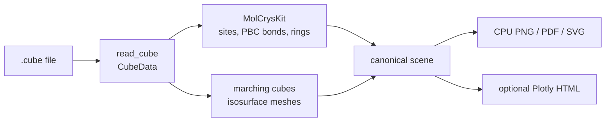

# Cube and isosurface API

Cube support is a volumetric-data adapter, not an independent chemistry
renderer. MatterVis parses the grid, sends the embedded atoms and periodic
cell through the canonical MolCrysKit structure contract, and then adds the
positive and negative isosurface meshes to the backend-neutral scene.



## Installation boundary

- Parse ordinary structures and render PNG/PDF/SVG: base `matter-vis`.
- Parse a Cube grid and extract isosurfaces: `matter-vis[cube]`.
- Render a Cube scene to Plotly HTML: `matter-vis[cube,plotly]`.
- Use Plotly/Kaleido static export: `matter-vis[cube,plotly-export]`.

Run `mat-vis capabilities --require cube --json` for the exact command in the
current environment. Importing `mat_viewer`, `mat_viewer.cube`, or
`mat_viewer.cube.core` does not import scikit-image or Plotly; those packages
are loaded only when their adapters are called.

## Agent-first entry points

Use the same public API as other structure formats:

```python
from mat_viewer.agent import load_structure, prepare_render, render

source = load_structure("density.cube")
plan = prepare_render(source)
result = render(plan, output="density.svg", backend="cpu")
```

The equivalent CLI is:

```console
mat-vis render density.cube -o density.svg --backend cpu --check --json
mat-vis render density.cube -o density.svg --backend cpu --json
```

`--check` resolves `[cube]` without loading the file or creating output.

For the optional Plotly frontend, `build_cube_figure(path, ...)` is the public
bridge. It still obtains atoms, bonds, image shifts, and display fragments from
the canonical loader before adding the isosurface overlay.

## Stable data surface

- `CubeAtom` and `CubeData` hold embedded atoms, origin, axes, and scalar data.
- `read_cube(path) -> CubeData` performs pure Cube IO.
- `cube_atom_trace(cube, theme="canonical")` and
  `atom_sphere_traces(cube, theme="canonical")` use the canonical MatterVis
  element palette by default. Pass `theme="cpk"` explicitly for the legacy
  bright CPK colors; this choice affects only the cube atom/bond overlays.
- `tile_cube` and `tile_cube_data` explicitly replicate a scalar grid.
- `default_isovalue(values, percentile)` chooses a threshold strictly inside
  the positive/negative value range or fails when no surface can exist.
- `cube_isosurface_meshes(cube, ...)` in `mat_viewer.cube.cpu` lazily uses
  scikit-image and returns backend-neutral vertices, triangles, normals,
  colour, opacity, and ambient/diffuse material coefficients. Pass
  `color_cube` to attach per-vertex RGB sampled from a second `CubeData`.
- `ensure_cube_isosurfaces(structure)` attaches those meshes to the canonical
  scene consumed by CPU or Plotly renderers. Prepared meshes are kept only
  while the source grid, isovalue, stride, material, and color-cube settings
  are unchanged.

The static CPU renderer accepts `--isosurface-ambient` and
`--isosurface-diffuse` coefficients. Their sum must not exceed one. Defaults
(`0.68` and `0.32`) preserve the standard material; lower ambient and higher
diffuse values increase directional contrast without introducing white
specular highlights.

## Isosurface color

`--isosurface-color-cube` samples a second cube onto the isosurface in
physical coordinates. The position of a mesh vertex is the source cube's
origin plus that vertex in the scene frame. The color value is the
trilinear sample of the full-resolution color grid at the index implied by
the color cube's own origin and voxel axes. Equal array shapes are not
enough: a different origin or voxel vector selects a different scalar, and a
vertex that falls outside the color grid is an error.

`--isosurface-stride` coarsens only the marching-cubes mesh. It does not
downsample the color cube. `--isosurface-colormap bgr` maps the low end to
blue, the middle to green, and the high end to red. Other names use
Matplotlib. `--isosurface-color-range MIN MAX` sets that mapping. Omit it to
use the finite minimum and maximum of the color cube. A finite constant cube
with no range uses the colormap midpoint, which is green for `bgr`. A
supplied range maps a constant value through that range.
`--isosurface-color-center` places one value, often zero, at the middle of
an asymmetric range.

A nonfinite voxel with nonzero trilinear weight makes that sample an error.
A nonfinite voxel with zero weight does not: an exact grid point or grid
face ignores the unused corners, so `NaN * 0` is not evaluated. Nonfinite
voxels the surface does not touch are ignored. Omitting the color cube
keeps the positive and negative phase colors.

| Mode | Backend | Color |
|---|---|---|
| `surface` | CPU PNG | Per-vertex color. Smooth shading uses vertex normals; flat shading keeps the same colors with one illumination per face. |
| `surface` | CPU SVG/PDF | Per-face average of the vertex colors. Vector fills are one color per triangle. |
| `surface` | Plotly | `Mesh3d` vertex colors. |
| `wireframe` | CPU PNG | Endpoint colors along the projected edge. Perspective uses camera depth (`-z`), so depths 1 and 9 give the screen midpoint weights 0.9 and 0.1. |
| `wireframe` | CPU SVG/PDF | The same blend, drawn as solid steps of 4 px. A span is not replaced by its midpoint color. |
| `wireframe` | Plotly | Error. Use the CPU backend or `surface`. |
| either | matplotlib or GPU | Error. Those backends do not accept per-vertex or per-endpoint colors. |

```console
mat-vis render density.cube -o density.png --backend cpu \
  --isovalue 0.005 \
  --isosurface-color-cube potential.cube \
  --isosurface-color-range -0.04 0.02 \
  --isosurface-color-center 0 \
  --isosurface-colormap bgr
```

## Isosurface wireframe

Use `--isosurface-mode wireframe` to render each positive or negative cube
isosurface as the complete marching-cubes triangulation. Shared edges are
deduplicated, but triangulation diagonals are retained; the filled surface is
not drawn. This is independent of `--style wireframe`, which controls the
atom-and-bond representation.

```console
mat-vis render density.cube -o density.svg --backend cpu \
  --isovalue 0.005 --isosurface-mode wireframe \
  --isosurface-wireframe-width 1.0 \
  --isosurface-wireframe-opacity 1.0
```

The wireframe inherits `--isosurface-positive-color` and
`--isosurface-negative-color` when no color cube is given.
`--isosurface-stride` controls the marching-cubes mesh density. Sampled
endpoint colors are described in [Isosurface color](#isosurface-color).
Because this is a pure wireframe, rear edges are intentionally visible;
hidden-line removal is not promised. Dense meshes can produce large SVG/PDF
files.

Standalone `bond_traces`, `build_orbital_figure`, and
`build_orbital_panel_figure` are intentionally not exported. They inferred
chemistry from direct Euclidean distances, which loses periodic boundary bonds
and creates a second structure truth. Compose multiple completed views in an
external layout tool instead of using an independent panel chemistry path.

## Contracts and failure behaviour

- MolCrysKit owns bond thresholds, PBC image shifts, molecule grouping, rings,
  and formula-unit selection. Cube code never re-detects those relationships.
- `periodic=True` closes the scalar grid by appending wrapped endpoint planes;
  it does not create a structural supercell.
- `periodic_image_policy="cell"` keeps a canonical base-cell component;
  `"nearest_atom"` selects the image nearest a displayed canonical atom.
- A missing `[cube]` extra raises an installation error. The renderer never
  drops isosurfaces or disables component filtering silently.
- CPU vector output remains true vector geometry. Plotly 3D PDF/SVG export is
  rasterized by Plotly/Kaleido and is therefore a distinct explicit backend.
- Supply the final Plotly camera to `build_cube_figure`; changing it after the
  figure is built can desynchronize baked compass annotations.

## Common checks

```console
mat-vis inspect density.cube --json
mat-vis capabilities --require cube --json
mat-vis render density.cube -o density.png --backend cpu --check --json
```

If marching cubes reports that the level does not cross the data, choose an
explicit isovalue inside the scalar range. If isolated noise components remain,
use the component-size and atom-mask controls deliberately; absence of their
optional implementation is an error rather than a visual fallback.

## VTK offscreen figures

`mat_viewer.render.vtk_cube.render_cube_figure` writes one PNG through
PyVista. It is not a `mat-vis render --backend` choice and it does not
consume a `RenderPlan`.

Install the Python extra with:

```console
python -m pip install "matter-vis[vtk]"
```

PyVista is imported only when the function is called. Headless Linux also
needs a system OSMesa or EGL library (Debian/Ubuntu: `libosmesa6`). MatterVis
does not install system libraries. If no display and neither library is
loadable, the call raises `RuntimeError` before opening a window. A missing
library used to abort the interpreter inside VTK.

The isosurface grid and the color grid share one `origin`, one `axes` matrix,
and one shape. Voxel vectors are rows. A vertex index `(i, j, k)` is the
physical point `origin + (i, j, k) @ axes`, the same frame as `CubeData`.
Resample a color cube that uses a different grid before calling this
function. Omit `color_min` and `color_max` to use the finite minimum and
maximum of the color grid. A constant grid with no range uses the colormap
midpoint. `color_center` places one value, often zero, at the middle of an
asymmetric range; omitting it keeps a linear map. `colormap_stops` is a
sequence of at least two RGB triples in `0..255`. The default stops run blue,
cyan, green, yellow, red.

`isovalue=None` uses `default_isovalue`. One level is drawn. `periodic=True`
appends the wrapped endpoint plane (index `N` copies index 0), the same
closure as the CPU cube path, so the surface can reach the cell faces.
`repeat` translates the finished mesh, the atoms, and the supplied bonds by
`axes * shape`. It is not `periodic_image_policy`. Pass
`bond_finder(xyz, atomic_numbers)` when contacts that cross a cell boundary
have to be chosen after the repeat. This function does not choose elements
or distance cutoffs. Colors and radii are caller-supplied maps keyed by
atomic number.

The isosurface shade is `surface_ambient`, `surface_diffuse`,
`surface_specular`, and `surface_specular_power`. Atom and bond
coefficients are the matching `atom_*` and `bond_*` arguments.
`surface_specular_power` is the Phong exponent, not a 0–1 weight.
The renderer lights both sides of the sheet, so an open isosurface stays
visible when a normal points away from the camera. The defaults leave the
previous coefficients unchanged.

`look` and `up` are directions. The camera distance and the three lights
scale with the scene radius, and the focal point is the center of the mesh
and atom bounds, so a volume with no atoms still frames. `parallel_scale` is
the orthographic half-height in the length unit of `axes`. `depth_peels`
above 1 turns on depth peeling for this window. Taubin smoothing runs before
colors are sampled onto the moved vertices. A pass that collapses the mesh
bounds is discarded. Smoothing can pull a periodic boundary off the cell face.

Two calls with the same arrays write the same PNG on one machine. A different
VTK build can move a few edge pixels.
