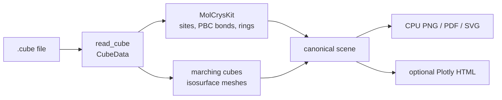

# Cube and isosurface API

Cube support is a volumetric-data adapter, not an independent chemistry
renderer. Atomaestro parses the grid, sends the embedded atoms and periodic
cell through the canonical MolCrysKit structure contract, and then adds the
positive and negative isosurface meshes to the backend-neutral scene.



## Installation boundary

- Parse ordinary structures and render PNG/PDF/SVG: base `matter-vis`.
- Parse a Cube grid and extract isosurfaces: `matter-vis[cube]`.
- Render a Cube scene to Plotly HTML: `matter-vis[cube,plotly]`.
- Use Plotly/Kaleido static export: `matter-vis[cube,plotly-export]`.

Run `mat-vis capabilities --require cube --json` for the exact command in the
current environment. Importing `mat_viewer`, `mat_viewer.cube`, or
`mat_viewer.cube.core` does not import scikit-image or Plotly; those packages
are loaded only when their adapters are called.

## Agent-first entry points

Use the same public API as other structure formats:

```python
from mat_viewer.agent import load_structure, prepare_render, render

source = load_structure("density.cube")
plan = prepare_render(source)
result = render(plan, output="density.svg", backend="cpu")
```

The equivalent CLI is:

```console
mat-vis render density.cube -o density.svg --backend cpu --check --json
mat-vis render density.cube -o density.svg --backend cpu --json
```

## Auto-view

`mat-vis render` of a cube frames the displayed atom spheres and the
marching-cubes vertices of both phases. The vertices are in the same
origin-subtracted scene frame as the atoms. The voxel-grid corners, the cube
box, and cell or axis lines do not set that frame, so a small orbital in a
padded grid stays at publication scale when the cell is drawn.

The automatic direction avoids the long axis of that point cloud. A 2pz-like
pair of lobes is shown from the side, with a small tilt, instead of end-on
as a disk. A nearly spherical surface falls back to a diagonal. Periodic
structure renders that do not draw an isosurface still use the largest
lattice face, with `c*` winning a cubic tie.

`--camera-axis`, `--view-direction`, and `--camera-position` replace the
automatic direction. `--camera-target` is the look-at point in scene
coordinates. `--ortho-scale` is the orthographic half-height in Å and
replaces the fitted scale. `--zoom` (`>1` zooms in) and `--framing-margin`
apply on `--renderer general` and on the batch renderer; `--check --json`
reports both. CPU and Plotly are not claimed to be visually identical.

Comparable panels must share one recorded direction, up vector, projection,
and viewport, and one explicit isovalue. `uniform_camera` copies the
reference plan's direction and up vector, keeps orthographic projection, and
uses the largest fitted half-height. Passing a different percentile isovalue
per panel is not that contract.

The automatic camera reads the isosurface vertices stored on the scene.
Those vertices are the visible mesh after a density mask, a cell clip, and
any smoothing. An empty stored list means nothing of the surface is drawn;
the fit does not march the cube again and restore the removed lobes. Zoom,
framing margin, orthographic scale, and an explicit view direction or
lattice axis go through `resolve_content_view`.

`--check` resolves `[cube]` without loading the file or creating output.

For the optional Plotly frontend, `build_cube_figure(path, ...)` is the public
bridge. It still obtains atoms, bonds, image shifts, and display fragments from
the canonical loader before adding the isosurface overlay.

## Stable data surface

- `CubeAtom` and `CubeData` hold embedded atoms, origin, axes, and scalar data.
- `read_cube(path) -> CubeData` performs pure Cube IO.
- `cube_atom_trace(cube, theme="canonical")` and
  `atom_sphere_traces(cube, theme="canonical")` use the canonical Atomaestro
  element palette by default. Pass `theme="cpk"` explicitly for the legacy
  bright CPK colors; this choice affects only the cube atom/bond overlays.
- `tile_cube` and `tile_cube_data` explicitly replicate a scalar grid.
- `default_isovalue(values, percentile)` chooses a threshold strictly inside
  the positive/negative value range or fails when no surface can exist.
- `cube_isosurface_meshes(cube, ...)` in `mat_viewer.cube.cpu` lazily uses
  scikit-image and returns backend-neutral vertices, triangles, normals,
  colour, opacity, and ambient/diffuse material coefficients. Pass
  `color_cube` to attach per-vertex RGB sampled from a second `CubeData`.
  Pass `density_mask=True` with a density `CubeData` and `density_cutoff`
  to clip the mesh to ρ ≤ ρ_cut. Crossing edges are interpolated. The flag
  defaults off. The returned vertices are the visible mesh.
- `ensure_cube_isosurfaces(structure)` attaches those meshes to the canonical
  scene consumed by CPU, matplotlib, Plotly, and GPU renderers. One mesh list
  is stored and replaced when the source grid, isovalue, stride, material,
  color-cube, or active density-mask settings change. A density cube is not
  part of that identity while the mask is off.

The static CPU renderer accepts `--isosurface-ambient` and
`--isosurface-diffuse` coefficients. Their sum must not exceed one. Defaults
(`0.68` and `0.32`) preserve the standard material; lower ambient and higher
diffuse values increase directional contrast without introducing white
specular highlights.

## Isosurface color

`--isosurface-color-cube` samples a second cube onto the isosurface in
physical coordinates. The position of a mesh vertex is the source cube's
origin plus that vertex in the scene frame. The color value is the
trilinear sample of the full-resolution color grid at the index implied by
the color cube's own origin and voxel axes. Equal array shapes are not
enough: a different origin or voxel vector selects a different scalar, and a
vertex that falls outside the color grid is an error.

`--isosurface-stride` coarsens only the marching-cubes mesh. It does not
downsample the color cube. `--isosurface-colormap bgr` maps the low end to
blue, the middle to green, and the high end to red. Other names use
Matplotlib. `--isosurface-color-range MIN MAX` sets that mapping. Omit it to
use the finite minimum and maximum of the color cube. A finite constant cube
with no range uses the colormap midpoint, which is green for `bgr`. A
supplied range maps a constant value through that range.
`--isosurface-color-center` places one value, often zero, at the middle of
an asymmetric range.

A nonfinite voxel with nonzero trilinear weight makes that sample an error.
A nonfinite voxel with zero weight does not: an exact grid point or grid
face ignores the unused corners, so `NaN * 0` is not evaluated. Nonfinite
voxels the surface does not touch are ignored. Omitting the color cube
keeps the positive and negative phase colors.

| Mode | Backend | Color |
|---|---|---|
| `surface` | CPU PNG | Per-vertex color. Smooth shading uses vertex normals; flat shading keeps the same colors with one illumination per face. |
| `surface` | CPU SVG/PDF | Per-face average of the vertex colors. Vector fills are one color per triangle. |
| `surface` | Plotly | `Mesh3d` vertex colors. |
| `wireframe` | CPU PNG | Endpoint colors along the projected edge. Perspective uses camera depth (`-z`), so depths 1 and 9 give the screen midpoint weights 0.9 and 0.1. |
| `wireframe` | CPU SVG/PDF | The same blend, drawn as solid steps of 4 px. A span is not replaced by its midpoint color. |
| `wireframe` | Plotly | Error. Use the CPU backend or `surface`. |
| either | matplotlib or GPU | Error. Those backends do not accept per-vertex or per-endpoint colors. |

```console
mat-vis render density.cube -o density.png --backend cpu \
  --isovalue 0.005 \
  --isosurface-color-cube potential.cube \
  --isosurface-color-range -0.04 0.02 \
  --isosurface-color-center 0 \
  --isosurface-colormap bgr
```

## Density mask

Optional high-density ceiling for an interaction isosurface such as a reduced
density gradient (RDG) or an interaction region indicator (IRI). The mask is
off unless you turn it on. Orbital and electron-density isosurfaces are
unchanged when the flag is omitted, even if a density-cube path and a cutoff
are sitting on the render spec. Do not enable the flag to clip an orbital or
a density isosurface. Cutting a density surface at ρ_cut only truncates that
contour, and this flag does not do that unless you turn it on for that render.

The cutoff uses the density cube's scalar values. For electron density those
values are atomic units, e/Bohr³ (1 a.u. ≈ 6.748 e/ų, so 0.05 a.u. ≈ 0.337
e/ų). Atomaestro does not convert e/ų. `read_cube` converts coordinates to
angstroms and leaves the scalars untouched.

When the mask is on, pass both a density cube and a cutoff ρ_cut > 0. If
either is missing, or the cutoff is not finite and positive, preparation
stops with an error. The isosurface is not masked by a silent default. The
program does not choose, infer, or correct ρ_cut.

Marching cubes runs on the loaded field. ρ is then sampled at the mesh
vertices in one Cartesian frame: the source origin plus voxel axes, mapped
into the density cube's own origin and axes. A grid with different spacing
or shape is sampled with trilinear interpolation when that frame covers the
surface. A triangle wholly above ρ_cut is removed. A triangle that crosses
ρ_cut is split where the sampled density field crosses ρ_cut. An edge longer
than one density voxel is subdivided until that parameter follows samples
spaced at most one voxel apart. A same-side edge is included when an interior
sample is on the other side of ρ_cut. An edge whose samples stay on one side
is left whole, so the cutoff is not the straight chord between the two
marching-cubes endpoint samples. Positions, normals, and colours use the same
parameter.
Dropping the whole triangle would make the hole follow the marching-cubes
stride. Vertices
above the cutoff are not drawn. The mesh stored on the scene is that
clipped result. Later smoothing or a camera fit has to use those vertices,
not the triangulation from before the mask. The field cube, the density cube, and any
colour cube are not rewritten. Colour range and colour mapping stay on the
full colour cube. Surviving vertices are not used to rescale sign(λ₂)ρ or
d_norm.

A density grid that cannot share that frame, including a Bohr grid that was
not stored in angstroms, or a grid that does not cover the surface, is an
error. A much coarser density grid still samples, and the clip can look
stair-stepped. This is a high-ρ ceiling. It is not a vacuum floor and it is
not a low-ρ Hirshfeld mask.

`ensure_cube_isosurfaces` keeps one mesh list on the scene and replaces it
when the isovalue, stride, material, colour cube, or active density mask
changes. A density cube that is not used, because the mask is off, is not
part of that identity. Cutoffs are not stored as a history.

State the mask and the cutoff in the figure caption. 0.05 a.u. is a
literature starting point for weak NCI/RDG contacts, not a software default
and not a universal value. The same 0.05 a.u. must not be copied from a
DFT/NCI convention onto a promolecular Slater field, and it is not
interchangeable across molecules, hydrogen-bond strengths, or descriptors.
Stronger or cyclic hydrogen bonds can sit above 0.05 a.u. in the interaction
region; 0.10 a.u. is only an example of a higher ceiling to try, not a second
default. For a standard IRI figure, leave the mask off. Those figures are
meant to show covalent basins and weak contacts together. A 0.05 ceiling is
an NCI-style crop and can delete strong hydrogen-bond basins.

A cutoff is also not a geometric bond-midpoint density. On one promolecular
Slater field for the formic acid cyclic dimer (not a DFT density), the H···O
midpoint was ρ ≈ 0.09 and was not a critical point. Using that midpoint as
ρ_cut would erase the RDG hydrogen-bond sheets on that field (ρ ≈ 0.037–0.051)
while remaining far below the IRI value at the same midpoint (about 3). On
that field the hydrogen-bond IRI isosurface sat near 1.5, against an RDG
isosurface near 0.5, and on a slightly different ρ neighborhood. Inspect ρ,
and the interaction field, on the isosurface of the descriptor you are
drawing. One global cutoff is not enough for both.

Without a mask, both an RDG isosurface near 0.5 and an official IRI
isosurface near 1.0 are flooded by covalent and atomic shells. Raising only
the density cutoff does not make IRI = 1.0 show hydrogen-bond disks on that
promolecular field: the attractive IRI on the RDG ≈ 0.5 hydrogen-bond sheet
was about 1.44–1.60. That is a field and isovalue question. It is not a
reason for the program to pick a cutoff.

Promolecular and SCF densities for the same geometry can disagree. A cutoff
that works on a mock can be too tight or too loose on a DFT cube. The mask
does not repair an inverted IRI definition or a nonstandard RDG prefactor.
Prefer an unmasked field cube plus this flag. The flag does not rewrite a
cube that was already cleared outside the cutoff; sampling it again can
over-cut.

```console
mat-vis render rdg.cube -o rdg.png --backend cpu \
  --isovalue 0.5 \
  --isosurface-density-mask \
  --isosurface-density-cube density.cube \
  --isosurface-density-cutoff 0.05
```

The 0.05 in that example is a user's choice for a weak-interaction RDG
figure. It is not the default. Omit `--isosurface-density-mask` for
orbitals, electron density, and a standard IRI figure.

```python
from mat_viewer.cube.cpu import cube_isosurface_meshes
from mat_viewer.cube.io import read_cube

meshes = cube_isosurface_meshes(
    read_cube("rdg.cube"),
    isovalue=0.5,
    density_mask=True,
    density_cube=read_cube("density.cube"),
    density_cutoff=0.05,
)
```

`RenderSpec(isosurface_density_mask=True, isosurface_density_cube=..., isosurface_density_cutoff=...)`
is the same switch for `prepare_render` and `render`.

## Isosurface wireframe

Use `--isosurface-mode wireframe` to render each positive or negative cube
isosurface as the complete marching-cubes triangulation. Shared edges are
deduplicated, but triangulation diagonals are retained; the filled surface is
not drawn. This is independent of `--style wireframe`, which controls the
atom-and-bond representation.

```console
mat-vis render density.cube -o density.svg --backend cpu \
  --isovalue 0.005 --isosurface-mode wireframe \
  --isosurface-wireframe-width 1.0 \
  --isosurface-wireframe-opacity 1.0
```

The wireframe inherits `--isosurface-positive-color` and
`--isosurface-negative-color` when no color cube is given.
`--isosurface-stride` controls the marching-cubes mesh density. Sampled
endpoint colors are described in [Isosurface color](#isosurface-color).
Because this is a pure wireframe, rear edges are intentionally visible;
hidden-line removal is not promised. Dense meshes can produce large SVG/PDF
files.

Standalone `bond_traces`, `build_orbital_figure`, and
`build_orbital_panel_figure` are intentionally not exported. They inferred
chemistry from direct Euclidean distances, which loses periodic boundary bonds
and creates a second structure truth. Compose multiple completed views in an
external layout tool instead of using an independent panel chemistry path.

## Contracts and failure behaviour

- MolCrysKit owns bond thresholds, PBC image shifts, molecule grouping, rings,
  and formula-unit selection. Cube code never re-detects those relationships.
- `build_cube_figure(..., periodic=True)` and style `isosurface_periodic` on
  the legacy Plotly trace path close the scalar grid by appending wrapped
  endpoint planes. That does not create a structural supercell. `mat-vis
  render` does not do this. `--periodic-isosurface` is an error on that
  command, and `--no-periodic-isosurface` matches the CPU meshes.
- `periodic_image_policy="cell"` and `"nearest_atom"` are likewise read by
  that legacy trace path, not by `ensure_cube_isosurfaces`.
- `isosurface_atom_mask_radius` and `isosurface_min_volume_voxels` are builtin
  style keys read by the legacy Plotly trace builder and by
  `orbital_mesh_traces`. They are not CLI flags. `ensure_cube_isosurfaces`
  does not apply them, so they do not change `mat-vis render`.
- A missing `[cube]` extra raises an installation error. The renderer never
  drops an explicitly requested isosurface. It also does not invent a density
  cutoff when the mask is missing an input.
- CPU vector output remains true vector geometry. Plotly 3D PDF/SVG export is
  rasterized by Plotly/Kaleido and is therefore a distinct explicit backend.
- Supply the final Plotly camera to `build_cube_figure`; changing it after the
  figure is built can desynchronize baked compass annotations.

## Common checks

```console
mat-vis inspect density.cube --json
mat-vis capabilities --require cube --json
mat-vis render density.cube -o density.png --backend cpu --check --json
```

If marching cubes reports that the level does not cross the data, choose an
explicit isovalue inside the scalar range. Component-size and atom-mask style
keys do not run on `mat-vis render`. Use an explicit isovalue, stride, and,
for an interaction isosurface, the opt-in density mask.
