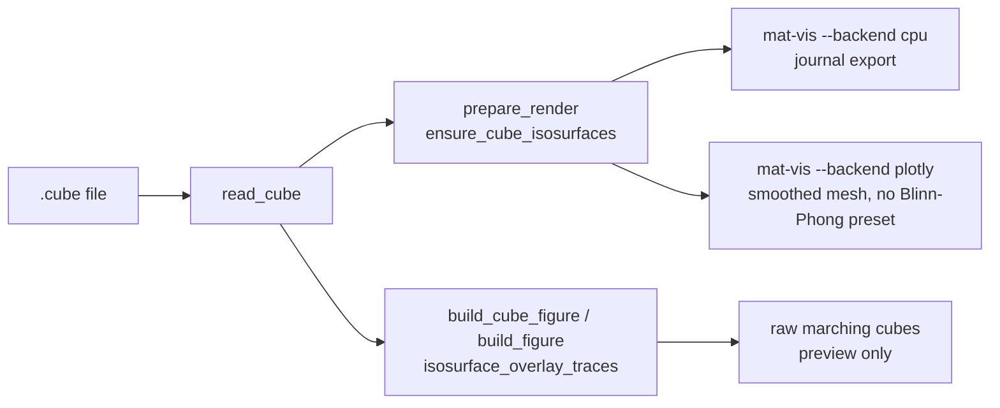

# Cube and isosurface API

Cube support is a volumetric-data adapter, not an independent chemistry
renderer. Atomaestro parses the grid, sends the embedded atoms and periodic
cell through the canonical MolCrysKit structure contract, and then adds the
positive and negative isosurface meshes to the backend-neutral scene.



## Installation boundary

- Parse ordinary structures and render PNG/PDF/SVG: base `matter-vis`.
- Parse a Cube grid and extract isosurfaces: `matter-vis[cube]`.
- Render a Cube scene to Plotly HTML: `matter-vis[cube,plotly]`.
- Use Plotly/Kaleido static export: `matter-vis[cube,plotly-export]`.

Run `mat-vis capabilities --require cube --json` for the exact command in the
current environment. Importing `mat_viewer`, `mat_viewer.cube`, or
`mat_viewer.cube.core` does not import scikit-image or Plotly; those packages
are loaded only when their adapters are called.

## Agent-first entry points

Use the same public API as other structure formats:

```python
from mat_viewer.agent import load_structure, prepare_render, render

source = load_structure("density.cube")
plan = prepare_render(source)
result = render(plan, output="density.svg", backend="cpu")
```

The equivalent CLI is:

```console
mat-vis render density.cube -o density.svg --backend cpu --check --json
mat-vis render density.cube -o density.svg --backend cpu --json
```

`--check` resolves `[cube]` without loading the file or creating output.

`build_cube_figure(path, ...)` is the Plotly figure helper. It still obtains
atoms, bonds, image shifts, and display fragments from the canonical loader,
then `build_figure` adds `isosurface_overlay_traces`. That overlay reruns
`skimage.measure.marching_cubes`. It does not call `ensure_cube_isosurfaces`,
does not Taubin-smooth, and uses Mesh3d lighting ambient 1, diffuse 0,
specular 0. It is a preview, not a journal figure.

## Stable data surface

- `CubeAtom` and `CubeData` hold embedded atoms, origin, axes, and scalar data.
- `read_cube(path) -> CubeData` performs pure Cube IO.
- `cube_atom_trace(cube, theme="canonical")` and
  `atom_sphere_traces(cube, theme="canonical")` use the canonical Atomaestro
  element palette by default. Pass `theme="cpk"` explicitly for the legacy
  bright CPK colors; this choice affects only the cube atom/bond overlays.
- `tile_cube` and `tile_cube_data` explicitly replicate a scalar grid.
- `default_isovalue(values, percentile)` chooses a threshold strictly inside
  the positive/negative value range or fails when no surface can exist.
- `cube_isosurface_meshes(cube, ...)` in `mat_viewer.cube.cpu` lazily uses
  scikit-image and returns backend-neutral vertices, triangles, normals,
  colour, opacity, and ambient/diffuse material coefficients. Pass
  `color_cube` to attach per-vertex RGB sampled from a second `CubeData`.
  Positive and negative phases stay separate meshes.
- `prepare_render` calls `ensure_cube_isosurfaces`. Taubin filtering
  (λ = 0.5, μ = −0.53, 15 iterations) runs only when `isosurface_smooth`
  is true. The default is the historical raw mesh at stride 2.
  `mat-vis render --backend cpu --isosurface-stride 1 --isosurface-smooth`
  draws the fine publication mesh.
  `mat-vis render --backend plotly` draws the same prepared geometry through
  `render.plotly`. Smoothing is a visual filter: it does not change which
  voxels are inside the surface. Vertices on the cube-box boundary stay
  pinned, and any vertex the μ step carries past the data box is placed
  back on that face before normals and colors are computed. Normals are the
  scalar-field gradient, sampled with central differences and mapped by
  `(J^{-1})^T`. A vertex with a tiny gradient, or one outside the grid,
  keeps the area-weighted mesh normal. The gradient field is flipped
  together when it disagrees with that marching-cubes winding.
  Omitting `--isosurface-smooth` keeps the raw marching-cubes mesh. A second
  cube's colors are resampled at the vertices that are drawn.
  `render.plotly` does not pass `surface_material` into Mesh3d lighting, so
  `hard_plastic`, `metal_like`, and `glass_like` are rejected on
  `--backend plotly` and `--backend gpu` instead of being attached and ignored.
- `build_cube_figure` and `build_figure` do not use those meshes.
  `isosurface_overlay_traces` and `orbital_mesh_traces` rerun raw
  `skimage.measure.marching_cubes` and ignore `scene["isosurfaces"]`.
  Their Mesh3d lighting is ambient 1, diffuse 0, specular 0. That path is
  an interactive preview, not publication quality. Journal figures use
  `mat-vis render --backend cpu`.
- `ensure_cube_isosurfaces(structure)` stores the prepared CPU meshes.
  They are kept only while the source grid, isovalue, stride, smoothing,
  material, and color-cube settings still match. The preparation token
  defaults to the same raw-mesh contract as that function. Those meshes
  are what `prepare_render` consumes. `build_figure` does not.
- CPU, CLI, and the builtin style default to `isosurface_stride=2` and
  `isosurface_smooth=False`. `--isosurface-stride 1 --isosurface-smooth`
  is the fine publication mesh.

`--isosurface-ambient` and `--isosurface-diffuse` are the historical Lambert
pair used when no specular preset is selected. `RenderSpec` still requires
that pair's sum to be at most 1. The defaults 0.68 and 0.32 reproduce that
Lambert response and do not add a specular highlight.

`surface_material` is a separate CPU record. Its ambient and diffuse need
not sum to 1. `matte` keeps the historical response. `hard_plastic` and
`metal_like` add specular highlights on the smoothed CPU vertex normals.
On a translucent isosurface the CPU PNG compositor adds that specular
without multiplying it by the surface opacity. `glass_like` also clears the
face-on center and thickens the silhouette; opaque atoms and bonds stay
opaque. They do not recolor the phase. Plotly Mesh3d lighting does not
evaluate them, including on a Taubin mesh from `mat-vis render --backend plotly`.
`hard_plastic`, `metal_like`, and `glass_like` are rejected on `--backend plotly`
and `--backend gpu`. Opacity stays 0.55 unless `--isosurface-opacity` is set,
and that value still scales the glass rim. Historical 0.68 and 0.32 do not
conflict with `matte`. `metal` and `glass` are rejected. See
[`surface_material.md`](surface_material.md). `build_cube_figure` does not
evaluate these presets.

```bash
mat-vis render orbital.cube -o raw.png --backend cpu --renderer general
mat-vis render orbital.cube -o smooth.png --backend cpu --renderer general \
  --isosurface-stride 1 --isosurface-smooth
```

## Isosurface material

`IsosurfaceMaterial` copies coefficients from the surface-material library.
It does not keep a private preset table. `opacity` is the object alpha and
is not part of the coefficient record. `light_scale` raises and is not
folded into diffuse or specular. Omitted coefficients stay the historical
Lambert pair, ambient 0.68 and diffuse 0.32, specular 0. A number on
`RenderSpec` is explicit even when it equals that default, so it conflicts
with `isosurface_material`.

The CPU surface shader evaluates the copied record, including `glass_like`
Fresnel and `metal_like` base tint. `shade_albedo`, Matplotlib, and Plotly
reject a non-neutral Fresnel record or a non-white specular tint instead of
dropping it. Plotly forwards in-range ambient, diffuse, and specular
unchanged and uses its own Cook-Torrance highlight. The GPU backend rejects
an isosurface mesh rather than drawing one flat color.


## Isosurface color

`--isosurface-color-cube` samples a second cube onto the isosurface in
physical coordinates. The position of a mesh vertex is the source cube's
origin plus that vertex in the scene frame. The color value is the
trilinear sample of the full-resolution color grid at the index implied by
the color cube's own origin and voxel axes. Equal array shapes are not
enough: a different origin or voxel vector selects a different scalar, and a
vertex that falls outside the color grid is an error.

`--isosurface-stride` coarsens only the marching-cubes mesh. It does not
downsample the color cube. `--isosurface-colormap bgr` maps the low end to
blue, the middle to green, and the high end to red. Other names use
Matplotlib. `--isosurface-color-range MIN MAX` sets that mapping. Omit it to
use the finite minimum and maximum of the color cube. A finite constant cube
with no range uses the colormap midpoint, which is green for `bgr`. A
supplied range maps a constant value through that range.
`--isosurface-color-center` places one value, often zero, at the middle of
an asymmetric range.

Sampled colors are the albedo for the shared material. Shading multiplies
them and may add a white specular term; it does not replace the colormap.
A nonfinite voxel with nonzero trilinear weight makes that sample an error.
A nonfinite voxel with zero weight does not: an exact grid point or grid
face ignores the unused corners, so `NaN * 0` is not evaluated. Nonfinite
voxels the surface does not touch are ignored. Omitting the color cube
keeps the positive and negative phase colors.

| Mode | Backend | Color |
|---|---|---|
| `surface` | CPU PNG | Per-vertex color, then the shared material. Smooth shading uses vertex normals; flat shading keeps the same colors with one illumination per face. |
| `surface` | CPU SVG/PDF | Per-face average of the vertex colors. Vector fills are one color per triangle. |
| `surface` | Plotly | `Mesh3d` vertex colors. |
| `wireframe` | CPU PNG | Endpoint colors along the projected edge. Perspective uses camera depth (`-z`), so depths 1 and 9 give the screen midpoint weights 0.9 and 0.1. |
| `wireframe` | CPU SVG/PDF | The same blend, drawn as solid steps of 4 px. A span is not replaced by its midpoint color. |
| `wireframe` | Plotly | Error for per-endpoint colors. Use the CPU backend or `surface`. Wireframe lines are unlit and do not apply the shared material. |
| either | matplotlib or GPU | Error. Those backends do not accept per-vertex or per-endpoint colors. |

```console
mat-vis render density.cube -o density.png --backend cpu \
  --isovalue 0.005 \
  --isosurface-color-cube potential.cube \
  --isosurface-color-range -0.04 0.02 \
  --isosurface-color-center 0 \
  --isosurface-colormap bgr
```

## Isosurface wireframe

Use `--isosurface-mode wireframe` to render each positive or negative cube
isosurface as the complete marching-cubes triangulation. Shared edges are
deduplicated, but triangulation diagonals are retained; the filled surface is
not drawn. This is independent of `--style wireframe`, which controls the
atom-and-bond representation.

```console
mat-vis render density.cube -o density.svg --backend cpu \
  --isovalue 0.005 --isosurface-mode wireframe \
  --isosurface-wireframe-width 1.0 \
  --isosurface-wireframe-opacity 1.0
```

The wireframe inherits `--isosurface-positive-color` and
`--isosurface-negative-color` when no color cube is given.
`--isosurface-stride` controls the marching-cubes mesh density. Sampled
endpoint colors are described in [Isosurface color](#isosurface-color).
Because this is a pure wireframe, rear edges are intentionally visible;
hidden-line removal is not promised. Dense meshes can produce large SVG/PDF
files.

Standalone `bond_traces`, `build_orbital_figure`, and
`build_orbital_panel_figure` are intentionally not exported. They inferred
chemistry from direct Euclidean distances, which loses periodic boundary bonds
and creates a second structure truth. Compose multiple completed views in an
external layout tool instead of using an independent panel chemistry path.

## Contracts and failure behaviour

- MolCrysKit owns bond thresholds, PBC image shifts, molecule grouping, rings,
  and formula-unit selection. Cube code never re-detects those relationships.
- `periodic=True` closes the scalar grid by appending wrapped endpoint planes;
  it does not create a structural supercell.
- `periodic_image_policy="cell"` keeps a canonical base-cell component;
  `"nearest_atom"` selects the image nearest a displayed canonical atom.
- A missing `[cube]` extra raises an installation error. The renderer never
  drops isosurfaces or disables component filtering silently.
- CPU vector output remains true vector geometry. Plotly 3D PDF/SVG export is
  rasterized by Plotly/Kaleido and is therefore a distinct explicit backend.
- Supply the final Plotly camera to `build_cube_figure`; changing it after the
  figure is built can desynchronize baked compass annotations.

## Common checks

```console
mat-vis inspect density.cube --json
mat-vis capabilities --require cube --json
mat-vis render density.cube -o density.png --backend cpu --check --json
```

If marching cubes reports that the level does not cross the data, choose an
explicit isovalue inside the scalar range. If isolated noise components remain,
use the component-size and atom-mask controls deliberately; absence of their
optional implementation is an error rather than a visual fallback.

Publication orbitals, density, and Hirshfeld surfaces stay on `studio_soft`.
`unlit` is for color-critical NCI/IRI plots, not the journal default for
those surfaces. See [`lighting.md`](lighting.md).
