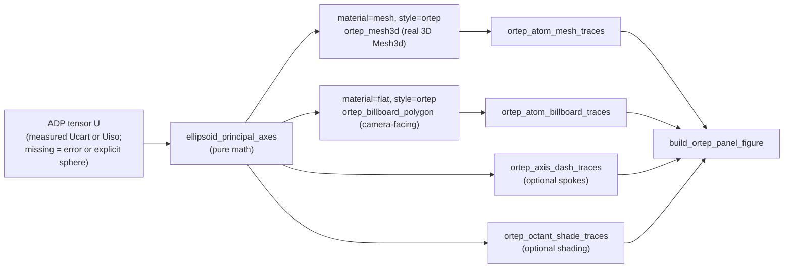

# ORTEP / thermal ellipsoid API

Atomaestro supports two ORTEP-style paths:

- `material="mesh", style="ortep"` for real interactive Plotly Mesh3d
  ellipsoids.
- `material="flat", style="ortep"` for publication-style billboards. In the
  Dash viewer this path includes a hidden Plotly 3D camera anchor; orbit events
  are converted back to the flat renderer's `view_direction`/`up` basis and
  refresh the embedded image. Static Matplotlib export remains unchanged.
  The anchor's `layout.scene.camera` is a Plotly camera (`eye`, `center`,
  `up`, and optional `projection`). A stored legacy `position` /
  `focal_point` camera is converted before that layout is built. A
  zero-length look vector uses the existing finite eye fallback. Non-finite
  components are left for Plotly to reject. The stored scene camera is not
  rewritten by the figure build.
  The publication raster is a paper image under that orbit scene. The scene
  background is transparent so the raster stays visible. An opaque scene
  background covers the drawing and leaves only the caption. The orbit
  anchor stores coordinates. An array-valued anchor already counts as
  geometry. A local viewer of this code also showed those columns as
  Plotly typed-array objects (`dtype` and non-empty `bdata`), which an
  array-length check does not see. The camera geometry check counts that
  payload. Marker opacity is not part of the check. A layout image does
  not stand in for missing coordinates, and its source is not compared
  with the scene, generation, or revision. A screenshot that matches the
  layout image currently on screen shows that this image is the visible
  picture. It does not show that the image belongs to the current scene,
  generation, or revision, so a visible but stale image is not evidence
  of the latest intent. The earlier parent-session
  camera toast was not captured with its live graph. A later parent
  session that did not report the toast does not assign that toast to
  this clause and does not clear it.

The CIF parser reads `_atom_site_aniso_U_*` into `atom["U"]`; missing
anisotropic data falls back to `_atom_site_U_iso_or_equiv`.

## Layers

- Pure math:
  `ellipsoid_principal_axes`, `ortep_mesh3d`,
  `ortep_billboard_polygon`, `ortep_principal_axis_segments`,
  `ortep_octant_shading`.
- Trace builders:
  `ortep_atom_mesh_traces`, `ortep_atom_billboard_traces`,
  `ortep_axis_dash_traces`, `ortep_octant_shade_traces`.
- Wrapper:
  `build_ortep_panel_figure`.

The render path branches on the `material` + `style` combination, so a
caller picks the visual language by setting two style keys; everything
upstream is shared:

This is the same `math → trace builder → wrapper` shape used by
`cube`, `compass`, and `scene`: callers who outgrow the wrapper drop
one layer down, never monkey-patch the wrapper.

## Style keys

- `ortep_probability` — default `0.5`, matching the common 50%
  probability ORTEP convention.
- `ortep_mode_minor` — optional mode used only for minor / disordered
  atoms. When omitted, minor atoms use the same `ortep_mode` as the
  rest of the scene. Setting `ortep_mode_minor="ortep_axes"` renders
  minor atoms as unfilled projected ellipsoid outlines plus principal
  axes, which pairs cleanly with dashed disorder bonds in static
  crystallographic panels.
- `ortep_show_principal_axes` — draw the three principal-axis spokes.
- `ortep_axis_color`, `ortep_axis_linewidth` — principal-axis styling.
- `ortep_octant_shading`, `ortep_octant_shadow_color`,
  `ortep_octant_shadow_alpha` — optional flat publication shading hooks.

All styling remains caller-overridable via kwargs or the `style` dict.
