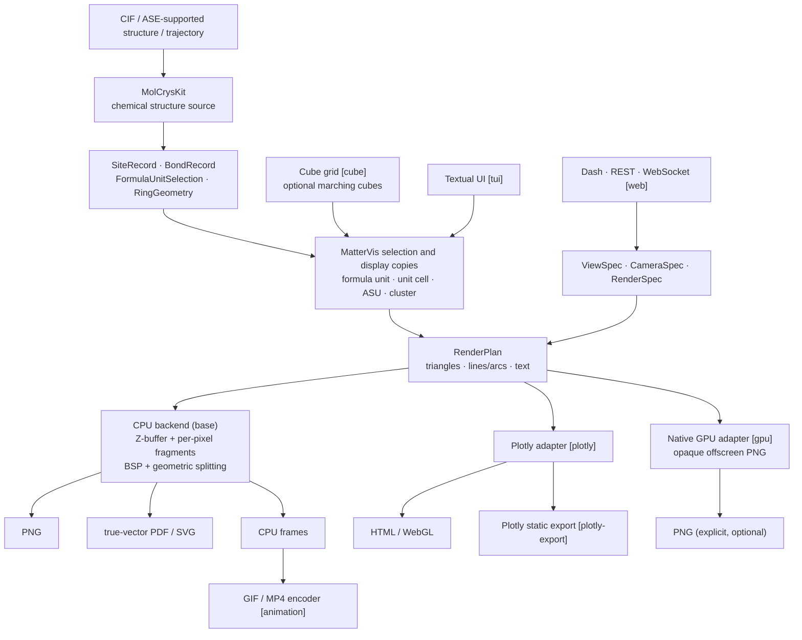

# MatterVis Architecture

MatterVis has one chemistry source and several explicitly selected output
frontends. The base installation owns the complete browser-independent static
path; an optional frontend may consume the same `RenderPlan`, but it may not
recompute chemical identity or silently replace another backend.

## Scientific effects

Display, Analysis, and Operate are separate effects. Display changes a
view. Analysis reads one immutable snapshot. Operate commits a new
structure revision through `EffectSession`. The legacy `supercell`
shorthand remains a display repeat. Details and the structural
commands are in
[display-operate-analysis.md](architecture/display-operate-analysis.md).

## Ownership

| Layer | Owns | Must not own |
|---|---|---|
| MolCrysKit | symmetry-expanded sites, molecule and ASU identity, PBC bonds, ADPs, rings, formula-unit selection | cameras, colors, output formats |
| MatterVis selection | which public records and periodic images are displayed | re-perceived bonds or private MolCrysKit `.info` fields |
| representation | ball-and-stick, space filling, wireframe, ORTEP, aromatic circle/disk | renderer selection |
| shading | smooth, flat, ORTEP axes/hatch | chemical topology or output format |
| camera | one homogeneous orthographic/perspective transform and clipping contract | chemistry or backend fallback |
| backend | CPU, Plotly, or optional GPU conversion of an existing `RenderPlan` | changing representation or chemistry |
| encoder/frontend | HTML, Web service, TUI, GIF/MP4, Cube mesh extraction | implicit installation or backend switching |

ORTEP is a representation, `flat` is shading, and `cpu`/`plotly`/`gpu` are
backends. Those choices remain independent in both the Python contracts and
the CLI.

## Static rendering

Every visible object is compiled from the bottom up into backend-neutral
primitives. Atoms and ellipsoids become triangle meshes; bonds and polyhedron
surfaces become meshes and edge segments; aromatic circles and ORTEP hatches
become depth-tested line segments; labels remain text.

The PNG renderer keeps one global opaque Z-buffer and a per-pixel list of
transparent fragments. The PDF/SVG renderer clips and triangulates surfaces,
splits intersecting polygons with a BSP, and splits strokes at projected
occlusion boundaries before writing vector paths. An embedded full-page PNG
is not a vector backend.

## Dependency direction

The base path may import only base dependencies. Optional modules are loaded
at the operation that needs them:

- Plotly HTML: `matter-vis[plotly]`;
- Plotly static export: `matter-vis[plotly-export]`;
- Dash, REST, and WebSocket: `matter-vis[web]`;
- Web/API screenshots and the Web UI's Plotly static export:
  `matter-vis[plotly-export,web]` (requirements `web-screenshot` and
  `static-web-export`);
- terminal UI: `matter-vis[tui]`;
- Cube isosurfaces: `matter-vis[cube]`;
- GIF/MP4 encoding: `matter-vis[animation]`.
- native offscreen PNG/GIF/MP4: `matter-vis[gpu]` (wgpu; runtime device probe required; GIF/MP4 also need `matter-vis[animation]`).

The GPU backend is explicit. It lowers the same immutable `RenderPlan`,
draws opaque meshes and instanced spheres, cylinders, and solid ellipsoids,
and composites lines that are not one pixel wide from the GPU depth buffer.
Transparent primitives, dashed lines, and text are rejected. It never
substitutes the CPU renderer when the optional dependency, the device, or a
primitive is unavailable. CPU PNG and true-vector PDF/SVG remain the
reference paths.

`mat-vis capabilities` and `mat-vis render --check` are the authoritative
dependency resolver. No skill or installer maintains a second dependency
table.

## Live API session

An already-open Dash page and an external script share one `SceneStore`.
`POST /api/v2/state`, `POST /api/v2/intent`, scene CRUD, and the figure
WebSocket all commit through `ViewerBackend`. That commit schedules a
complete frame on `AsyncRenderWorker` when the change needs one, and
publishes a lightweight `view_update` when it does not. The page applies
those journal envelopes over the existing WebSocket, falling back to
`GET /api/v2/view-updates`. Scene-list changes travel in the same snapshot
and journal as `scene_catalog`. The page rebuilds the existing tab strip
and keeps the selected tab unless the caller explicitly focuses a scene,
the selected scene has been removed, or this page clicked Duplicate. That
click selects the new scene on this page only. Other pages keep their tab
because the catalog is published with `focus: false`. Control widgets follow the existing
agent-state poll, which re-reads the selected scene when its version clocks
move. In-process GUI edits that already own the gesture do not echo that
gesture back through the poll.

Publication is scene-scoped. A figure, camera, or sidebar capture for
scene A does not apply to scene B. `layout.scene.uirevision` includes the
scene id, so two scenes that share a structure and viewport do not keep
one WebGL camera. Duplicating a scene schedules a complete frame for the
copy. A build that is already running is published only when its
generation, render revision, and camera revision are still current; a
newer complete-frame identity is requeued, and an older one is dropped.
`update_view` supplies that frame from the requesting browser's mounted
figure: a process-wide camera or display classification does not skip the
frame when the mounted figure still belongs to another scene. The delivery
contract is `docs/reliability-scene-delivery.md`.

## Documentation of the render interface

MatterVis is a pure render interface. Stable docs describe geometry, bond
graphs, and display modes: which public records and periodic images are
shown, and how a backend lowers an existing `RenderPlan`. Chemistry
semantics — molecule grouping, PBC unwrapping, packing shells, shape
classification, disorder resolution, slabs, and related provenance — are
documented in MolCrysKit, the chemistry source in the diagram above.

Do not document chemistry heuristics (ionic or halide whitelists,
`is_ionic_solid` gates) as renderer behavior.

In-scope render, CLI, WebGL session/upload, architecture, and user-visible
display-policy changes update these docs in the same pull request. Missing
docs on an in-scope change is review P1. Paths, the out-of-scope list, and
the pull request template are in
[CONTRIBUTING.md](../CONTRIBUTING.md#documentation-policy).

## Scene-store shutdown

`ViewerBackend.close()` signals the persistence thread, stops render
executors with a fixed wait, joins that thread, and flushes the scene
store in a `finally` block. Workers still running after that wait are
detached from interpreter shutdown and `workers_quiescent` is false.
The detach drops CPython's private shutdown registries because a running
thread cannot be marked daemon through the public setter. A registry
that is not present is skipped, and the pool stays non-quiescent.
The backend lock is not held across the scene-file replace. `save` and
`flush_durable` share one flush lock from snapshot through conditional
clean. A mutation that arrives during the replace stays dirty. A final
flush that leaves the store dirty raises `SceneStorePersistError`.
The lock order, the bounds, and the root cause of the shutdown hang
are in `docs/reliability-worker-shutdown.md`.
