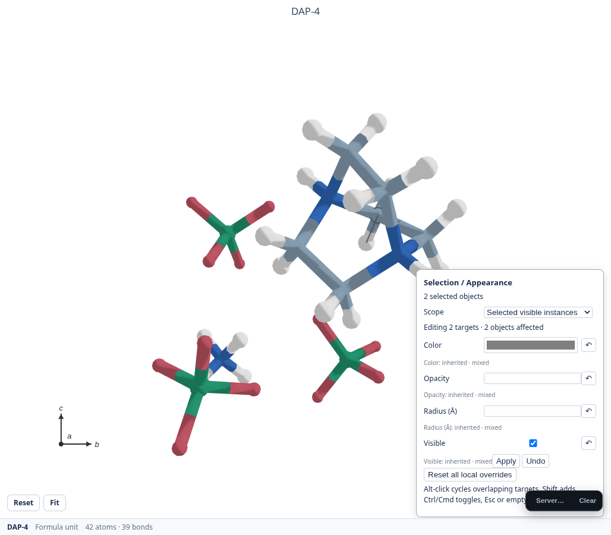
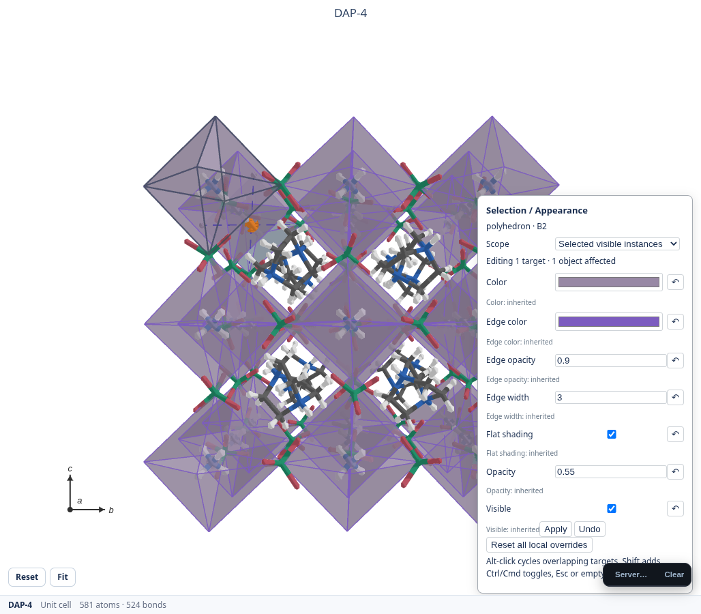
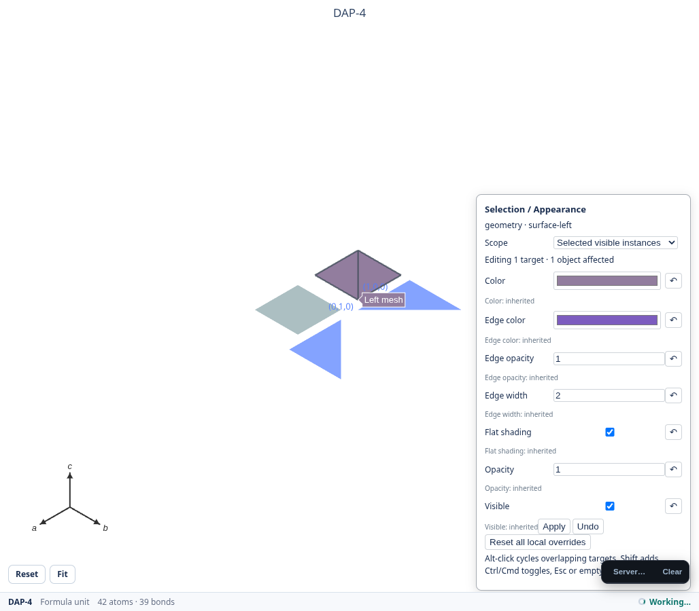
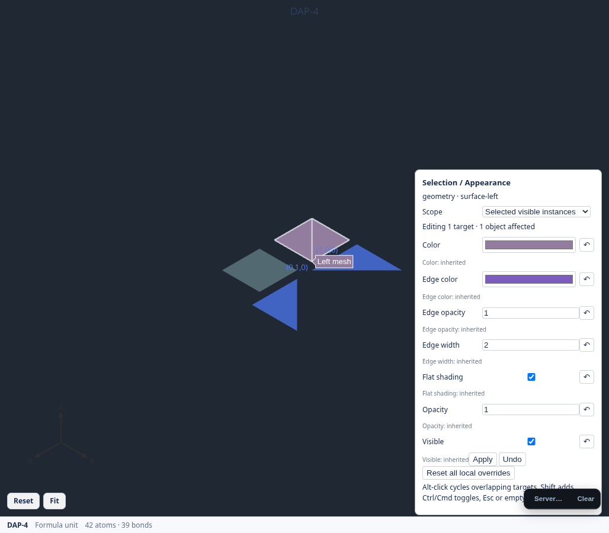

# Scene selection and appearance verification

Recorded on 2026-10-24 (Asia/Shanghai), Linux x86_64, AMD EPYC 7763
(5 visible CPUs), Chromium 154 with SwiftShader, 1400×900 browser viewport.

## Reproduce

```sh
python -m pytest tests/ -n 4 --dist loadfile
MATTERVIS_VISUAL_OUTPUT=/tmp/mattervis-selection \
  python -m pytest -s \
  tests/app/test_real_app_browser_regression.py::test_semantic_atom_click_survives_gl_fallback \
  tests/app/test_real_app_browser_regression.py::test_visible_mesh_and_bfdh_faces_share_native_picking
```

Create the output directory before requesting screenshots. Node, Playwright
and Chromium are needed for the browser gate. The browser tests use native
pointer gestures and real Plotly/WebGL geometry; they do not inject
`plotly_click` events to make a failed pick pass.

The organic acceptance flow covers hover, a visible persistent contour,
Ctrl-add/toggle, Escape, right-click without prior hover, orbit and right-pan
without accidental selection, saved recolor, deselection, a live element palette
change and reset to the latest inherited color. Surface tests pick two independent
meshes and a BFDH face, assert Miller metadata, and reproject through the existing
camera owner into orthographic mode. Executable Node contracts cover depth,
opaque/transparent overlap, hidden geometry, entire bond segments, stale indexes,
and rejection of spec-only edge aliases.

Additional real-app verification used DAP-4 in unit-cell mode with an N/ClO4
coordination spec. Clicking visible faces selected two canonical instances of
source 0, in images `(0,0,1)` and `(1,0,1)`. These were actual hull-face hits;
no center-marker or spec-wide ID was used.

## Measurements

150 deterministic samples, including occupied atom/face positions in the dense
case. Times below cover local query plus contour painting, without a Python
request. Other tests were running on the same cloud machine.

| Workload | Traces | Pick primitives | Median | p95 |
|---|---:|---:|---:|---:|
| Two meshes plus BFDH overlay | 7 | 6 | 0.2 ms | 0.4 ms |
| 5000 atom markers, 40 batched octahedra, mesh/BFDH overlays | 9 | 5326 | 0.4 ms | 0.6 ms |

The dense projected index took 95.8 ms to construct after invalidation. Steady
hover reuses it; camera/geometry changes rebuild it. Its serialized primitive
payload was 2,026,805 bytes; this is a payload-size measurement, not a claim
about total JavaScript heap allocation. There is one interaction canvas and no
extra Plotly trace per face or hover event. The browser gate asserts that hover
never calls `/selection/by_box`.

For 12 alternating single-polyhedron color changes plus Python figure assembly,
a warm DAP-4 unit-cell scene measured median 115.8 ms / p95 358.1 ms. Coordination
geometry was reused and source atom records were unchanged. This includes the
existing asynchronous figure-assembly path; it is not a shader-only paint
benchmark. Representation changes can rebuild atom render partitions. The
screen-grid/overlay path does not replace the existing camera owner.

Ruff currently reports pre-existing repository violations. Comparing diagnostic
code/message counts against the base revision showed no new violations from
this change. No repository-wide automatic lint rewrite was applied.

## Visual review fixtures

The element/scene colors remain visible; interaction feedback uses a neutral
rim/edge, with stronger persistent selection than hover.








